 

I am a **Forward Deployed Engineer at NOVIXO AI**. I work between a customer's problem and the software that solves it: I find out what the business actually needs, design the solution, build and integrate it on the cloud, and stay with it until people use it.

I came to this role in steps. I founded and ran a chain of three 24×7 gaming cafés, moved into data science, joined NOVIXO AI as an Associate Data Scientist working on machine learning and language processing for drug safety, and now deliver enterprise software to customers as a Forward Deployed Engineer. I have made payroll, negotiated with vendors and lost sleep over a broken billing counter, which is why I care whether software works for the person on the floor and not only in a demo.

 

A drug-safety (pharmacovigilance) platform for pharmaceutical companies and contract research organisations. Multi-tenant and serverless on AWS, designed for audit trails, electronic signatures and regulatory inspection. Each product can be used alone or together with the others.

<table>
<tr><th align="left" width="24%">Product&nbsp;&nbsp;&nbsp;&nbsp;&nbsp;&nbsp;&nbsp;&nbsp;&nbsp;&nbsp;&nbsp;&nbsp;&nbsp;&nbsp;&nbsp;&nbsp;&nbsp;</th><th align="left" width="40%">The&nbsp;customer's&nbsp;problem&nbsp;it&nbsp;solves</th><th align="left">My&nbsp;part&nbsp;&nbsp;&nbsp;&nbsp;&nbsp;&nbsp;&nbsp;&nbsp;&nbsp;&nbsp;&nbsp;&nbsp;&nbsp;&nbsp;&nbsp;&nbsp;&nbsp;&nbsp;&nbsp;&nbsp;&nbsp;&nbsp;&nbsp;&nbsp;&nbsp;&nbsp;&nbsp;&nbsp;&nbsp;&nbsp;&nbsp;&nbsp;&nbsp;&nbsp;&nbsp;&nbsp;&nbsp;&nbsp;&nbsp;</th></tr>
<tr>
<td valign="top"><b>Case Intake</b></td>
<td valign="top">Safety reports arrive as forms, e-mails and PDFs. This turns them into coded, reviewed and signed cases in the standard format regulators accept.</td>
<td valign="top">Release hardening, defect fixes, continuous integration and end-to-end validation of the multi-tenant platform, working with the founding engineer.</td>
</tr>
<tr>
<td valign="top"><b>Literature Monitoring</b></td>
<td valign="top">Companies must search medical journals every week for side effects of their products. This runs the searches, screens the articles and records every decision.</td>
<td valign="top">Led the engineering of literature acquisition and screening, and its integration into the platform.</td>
</tr>
<tr>
<td valign="top"><b>Quality Control</b></td>
<td valign="top">Checks the work done on each case independently, shows which step caused each error, and reports error rates and timeliness.</td>
<td valign="top">Independent end-to-end validation across the user roles, and the design of its link to case intake.</td>
</tr>
<tr>
<td valign="top"><b>Aggregate Reporting</b></td>
<td valign="top">Builds the periodic safety reports regulators require (PBRER/PSUR, PADER, DSUR) from frozen data, with every number traceable to its cases.</td>
<td valign="top">Leading the design and build of one configurable reporting engine for all three report types. <i>In development.</i></td>
</tr>
<tr>
<td valign="top"><b>Submissions and Acknowledgements</b></td>
<td valign="top">Sends each case to the right authority on time, tracks the answer and handles rejections.</td>
<td valign="top">Designing the versioned data contract that will connect it to reporting. <i>On the roadmap.</i></td>
</tr>
<tr>
<td valign="top"><b>Signal Detection and Management</b></td>
<td valign="top">Looks across all cases and articles for a new or changed risk, and follows it to a decision.</td>
<td valign="top">Designing the versioned data contract for its signal summaries. <i>On the roadmap.</i></td>
</tr>
</table>

`Python` `AWS Lambda` `DynamoDB` `S3` `Cognito` `Bedrock` `AWS CDK` `React` `TypeScript` `E2B(R3)` `multi-tenant isolation` `audit trails and e-signatures`

Proprietary work of NOVIXO AI. The code is private.

 

<table>
<tr><th align="left" width="24%">Project&nbsp;&nbsp;&nbsp;&nbsp;&nbsp;&nbsp;&nbsp;&nbsp;&nbsp;&nbsp;&nbsp;&nbsp;&nbsp;&nbsp;&nbsp;&nbsp;&nbsp;</th><th align="left" width="40%">The&nbsp;customer's&nbsp;problem&nbsp;it&nbsp;solves</th><th align="left">My&nbsp;part&nbsp;&nbsp;&nbsp;&nbsp;&nbsp;&nbsp;&nbsp;&nbsp;&nbsp;&nbsp;&nbsp;&nbsp;&nbsp;&nbsp;&nbsp;&nbsp;&nbsp;&nbsp;&nbsp;&nbsp;&nbsp;&nbsp;&nbsp;&nbsp;&nbsp;&nbsp;&nbsp;&nbsp;&nbsp;&nbsp;&nbsp;&nbsp;&nbsp;&nbsp;&nbsp;&nbsp;&nbsp;&nbsp;&nbsp;</th></tr>
<tr>
<td valign="top"><b>Booking and CRM platform</b> Home-services company, Melbourne</td>
<td valign="top">One system for the public website, online booking, quotes, job scheduling, reminders and customer records, replacing scattered tools.</td>
<td valign="top">Platform, data model, API and staff application, delivered with a colleague who led the visual front end.</td>
</tr>
<tr>
<td valign="top"><b>Relationship CRM and website</b> Events and media business</td>
<td valign="top">Turns a founder's network into structured memory, following each contact from relationship to enquiry, deal, client and referral.</td>
<td valign="top">Sole engineer, from requirements and design research to release.</td>
</tr>
</table>

`Next.js` `TypeScript` `Hono` `PostgreSQL` `Tailwind` `Vercel` `Vitest` `Playwright`

Client work. The code is private.

 

The code is private.

 

 

<b>Open the full experience log</b>

 

<table>
<tr><th align="left" width="30%">Role</th><th align="left">What I do, or did</th></tr>
<tr>
<td valign="top"><b>Forward Deployed Engineer</b> NOVIXO AI · present</td>
<td valign="top">Take enterprise software from a customer's requirement to working delivery: solution design, cloud and integration work, validation with the people who will use it, and the documents a regulated buyer asks for.</td>
</tr>
<tr>
<td valign="top"><b>Associate Data Scientist</b> NOVIXO AI</td>
<td valign="top">Data science, machine learning and natural language processing for pharmacovigilance: screening medical literature, removing duplicate articles, and finding the products and adverse events named in medical text.</td>
</tr>
<tr>
<td valign="top"><b>Data science training and projects</b> 2025 to 2026</td>
<td valign="top">Formal training in data science and artificial intelligence, and the public projects listed under Open work: fraud risk, automated modelling, forecasting and model explainability.</td>
</tr>
<tr>
<td valign="top"><b>Founder and operations manager</b> StunnShot · three 24×7 gaming cafés, New Delhi · 2017 to 2020</td>
<td valign="top">Owned the profit and loss, pricing, vendors, hiring and rosters across three locations at once. It taught me to listen for the real problem behind a request, to count the cost of every decision, and to be accountable when something fails at two in the morning.</td>
</tr>
</table>

 

 

 

&nbsp;
&nbsp;

New Delhi, India · sakshamsingriwal1997@gmail.com · every panel is drawn by <a href="scripts/build_assets.py">scripts/build_assets.py</a>

