 

I am a **Forward Deployed Engineer at NOVIXO AI**. I work between a customer's problem and the software that solves it: I find out what the business actually needs, design the solution, build and integrate it on the cloud, and stay with it until people use it.

I came to this role in steps. I founded and ran a chain of three 24×7 gaming cafés, studied computer applications and then business analytics, moved into data science through an internship at Spinnaker Analytics, joined NOVIXO AI as an Associate Data Scientist working on machine learning and language processing for drug safety, and now deliver enterprise software to customers as a Forward Deployed Engineer. I have made payroll, negotiated with vendors and lost sleep over a broken billing counter, which is why I care whether software works for the person on the floor and not only in a demo.

 

A drug-safety (pharmacovigilance) platform for pharmaceutical companies and contract research organisations. Multi-tenant and serverless on AWS, designed for audit trails, electronic signatures and regulatory inspection. Each product can be used alone or together with the others.

<table>
<tr><th align="left" width="24%">Product&nbsp;&nbsp;&nbsp;&nbsp;&nbsp;&nbsp;&nbsp;&nbsp;&nbsp;&nbsp;&nbsp;&nbsp;&nbsp;&nbsp;&nbsp;&nbsp;&nbsp;</th><th align="left" width="40%">The&nbsp;customer's&nbsp;problem&nbsp;it&nbsp;solves</th><th align="left">My&nbsp;part&nbsp;&nbsp;&nbsp;&nbsp;&nbsp;&nbsp;&nbsp;&nbsp;&nbsp;&nbsp;&nbsp;&nbsp;&nbsp;&nbsp;&nbsp;&nbsp;&nbsp;&nbsp;&nbsp;&nbsp;&nbsp;&nbsp;&nbsp;&nbsp;&nbsp;&nbsp;&nbsp;&nbsp;&nbsp;&nbsp;&nbsp;&nbsp;&nbsp;&nbsp;&nbsp;&nbsp;&nbsp;&nbsp;&nbsp;</th></tr>
<tr>
<td valign="top"><b>Case Intake</b></td>
<td valign="top">Safety reports arrive as forms, e-mails and PDFs. This turns them into coded, reviewed and signed cases in the standard format regulators accept.</td>
<td valign="top">Release hardening, defect fixes, continuous integration and end-to-end validation of the multi-tenant platform, working with the founding engineer.</td>
</tr>
<tr>
<td valign="top"><b>Literature Monitoring</b></td>
<td valign="top">Companies must search medical journals every week for side effects of their products. This runs the searches, screens the articles and records every decision.</td>
<td valign="top">Led the engineering of literature acquisition and screening, and its integration into the platform.</td>
</tr>
<tr>
<td valign="top"><b>Quality Control</b></td>
<td valign="top">Checks the work done on each case independently, shows which step caused each error, and reports error rates and timeliness.</td>
<td valign="top">Independent end-to-end validation across the user roles, and the design of its link to case intake.</td>
</tr>
<tr>
<td valign="top"><b>Aggregate Reporting</b></td>
<td valign="top">Builds the periodic safety reports regulators require (PBRER/PSUR, PADER, DSUR) from frozen data, with every number traceable to its cases.</td>
<td valign="top">Led the design and build of one configurable reporting engine for all three report types, with blinding protection for clinical trials and every number traceable to its cases.</td>
</tr>
<tr>
<td valign="top"><b>Submissions and Acknowledgements</b></td>
<td valign="top">Sends each case to the right authority on time, tracks the answer and handles rejections.</td>
<td valign="top">Verified the flow end to end: routing rules, the E2B(R3) message, acknowledgements, rejections and retries, tested against a receiving-system simulator.</td>
</tr>
<tr>
<td valign="top"><b>Signal Detection and Management</b></td>
<td valign="top">Looks across all cases and articles for a new or changed risk, and follows it to a decision.</td>
<td valign="top">Built detection and management: disproportionality alerts, validation by a second person, signed closure by the QPPV, and the signal summary that feeds the periodic report.</td>
</tr>
</table>

`Python` `AWS Lambda` `DynamoDB` `S3` `Cognito` `Bedrock` `AWS CDK` `React` `TypeScript` `E2B(R3)` `multi-tenant isolation` `audit trails and e-signatures`

Proprietary work of NOVIXO AI. The code is private.

 

<table>
<tr><th align="left" width="24%">Project&nbsp;&nbsp;&nbsp;&nbsp;&nbsp;&nbsp;&nbsp;&nbsp;&nbsp;&nbsp;&nbsp;&nbsp;&nbsp;&nbsp;&nbsp;&nbsp;&nbsp;</th><th align="left" width="40%">The&nbsp;customer's&nbsp;problem&nbsp;it&nbsp;solves</th><th align="left">My&nbsp;part&nbsp;&nbsp;&nbsp;&nbsp;&nbsp;&nbsp;&nbsp;&nbsp;&nbsp;&nbsp;&nbsp;&nbsp;&nbsp;&nbsp;&nbsp;&nbsp;&nbsp;&nbsp;&nbsp;&nbsp;&nbsp;&nbsp;&nbsp;&nbsp;&nbsp;&nbsp;&nbsp;&nbsp;&nbsp;&nbsp;&nbsp;&nbsp;&nbsp;&nbsp;&nbsp;&nbsp;&nbsp;&nbsp;&nbsp;</th></tr>
<tr>
<td valign="top"><b>Booking and CRM platform</b> Home-services company, Melbourne</td>
<td valign="top">One system for the public website, online booking, quotes, job scheduling, reminders and customer records, replacing scattered tools.</td>
<td valign="top">Platform, data model, API and staff application, delivered with a colleague who led the visual front end.</td>
</tr>
<tr>
<td valign="top"><b>Relationship CRM and website</b> Events and media business</td>
<td valign="top">Turns a founder's network into structured memory, following each contact from relationship to enquiry, deal, client and referral.</td>
<td valign="top">Sole engineer, from requirements and design research to release.</td>
</tr>
</table>

`Next.js` `TypeScript` `Hono` `PostgreSQL` `Tailwind` `Vercel` `Vitest` `Playwright`

Client work. The code is private.

 

The code is private.

 

 

<b>Open the full experience log</b>

 

<table>
<tr><th align="left" width="30%">Role</th><th align="left">What I do, or did</th></tr>
<tr>
<td valign="top"><b>Forward Deployed Engineer</b> NOVIXO AI · Noida, on-site · Oct 2026 to present</td>
<td valign="top">Design and deliver AI-enabled solutions for regulated drug-safety workflows, working across AI engineering, pharmacovigilance, product, compliance and customer teams. The work covers AI-assisted ICSR processing (document extraction, case-validity checks, MedDRA workflows, review and QC, E2B(R2/R3)), NLP, LLM and agentic AI workflows, and API- and MCP-based integrations, with human approval, role-based access and auditability built in. Turn PV, regulatory and customer requirements into technical workflows and implementation plans, and coordinate stakeholders from discovery and demos to implementation and handoff.</td>
</tr>
<tr>
<td valign="top"><b>Associate Data Scientist</b> NOVIXO AI · Jan 2026 to Oct 2026</td>
<td valign="top">Applied AI, machine learning and NLP in pharmacovigilance: preprocessing, exploratory analysis, feature engineering and validation on structured and unstructured drug-safety data. Worked on adverse-event identification, risk classification and case triage, with evaluation suited to compliance-sensitive settings and SHAP explanations for PV, compliance and non-technical stakeholders. Helped move AI from experimentation toward enterprise workflows with human review and traceability.</td>
</tr>
<tr>
<td valign="top"><b>Data Science Intern</b> Spinnaker Analytics · Boston, Massachusetts, remote · Oct 2025 to Dec 2025</td>
<td valign="top">Predictive analytics in Python, SQL, Pandas and NumPy: data cleaning, validation, exploratory analysis and preprocessing. Feature engineering, model development and evaluation on classification and forecasting projects, with every experiment and finding documented.</td>
</tr>
<tr>
<td valign="top"><b>Human Resources Intern</b> Engineers India Limited · New Delhi, on-site · Jun 2025 to Jul 2025</td>
<td valign="top">Planned the workforce budget for the international deployment of 77 employees and coordinated recruitment for more than 150 candidates. Prepared HR and compliance documentation, and Excel reports for workforce planning.</td>
</tr>
<tr>
<td valign="top"><b>Founder and Operations Manager</b> StunnShot · self-employed, New Delhi · Aug 2017 to Feb 2020</td>
<td valign="top">Founded and ran a chain of three 24×7 gaming cafés, owning the profit and loss, pricing, cash flow, costs, inventory and procurement. Hired, trained, scheduled and managed staff across three locations, negotiated with vendors and defined the operating processes. Tracked revenue, expenses and KPIs, and turned customer, staff and vendor feedback into improvements.</td>
</tr>
</table>

 

 

 

&nbsp;
&nbsp;

New Delhi, India · sakshamsingriwal1997@gmail.com · every panel is drawn by <a href="scripts/build_assets.py">scripts/build_assets.py</a>

